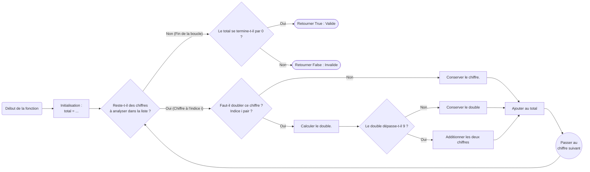

---
hide:
    - navigation
    - toc
title: Algorithme de Luhn
tags:
    - liste/tableau
    - boucle for
    - modulo
difficulty: 150
---

# Algorithme de Luhn — Validation de carte bancaire

L'**algorithme de Luhn** est une formule de somme de contrôle (*checksum*) utilisée pour vérifier la validité de divers numéros d'identification, notamment les numéros de **cartes bancaires** (Mastercard, Visa, etc.), les numéros de sécurité sociale ou les codes IMEI des téléphones portables.

Conçu en 1954 par Hans Peter Luhn, ingénieur chez IBM, cet algorithme permet de détecter les erreurs de saisie courantes (comme un chiffre erroné ou l'inversion de deux chiffres consécutifs).

---

## Fonctionnement de l'algorithme

Considérons le numéro de carte bancaire suivant à $16$ chiffres :

$$\mathbf{4137 \quad 8947 \quad 1175 \quad 5904}$$

En Python, on peut représenter ce numéro sous la forme d'une liste de $16$ entiers :
```python
chiffres = [4, 1, 3, 7, 8, 9, 4, 7, 1, 1, 7, 5, 5, 9, 0, 4]
```

Le calcul s'effectue en quatre étapes :

| Étape | Description | Résultat pour la carte exemple |
| :--- | :--- | :--- |
| **Liste initiale** | Les $16$ chiffres de la carte | <span class="luhn-digits"><span class="d">4</span><span class="d">1</span><span class="d">3</span><span class="d sep">7</span><span class="d">8</span><span class="d">9</span><span class="d">4</span><span class="d sep">7</span><span class="d">1</span><span class="d">1</span><span class="d">7</span><span class="d sep">5</span><span class="d">5</span><span class="d">9</span><span class="d">0</span><span class="d">4</span></span> |
| **Étape 1** | **Doubler la valeur** un élément sur deux (les indices pairs $0, 2, 4\dots$) | <span class="luhn-digits"><span class="d doubled">8</span><span class="d">1</span><span class="d doubled">6</span><span class="d sep">7</span><span class="d doubled">16</span><span class="d">9</span><span class="d doubled">8</span><span class="d sep">7</span><span class="d doubled">2</span><span class="d">1</span><span class="d doubled">14</span><span class="d sep">5</span><span class="d doubled">10</span><span class="d">9</span><span class="d doubled">0</span><span class="d">4</span></span> |
| **Étape 2** | Si le résultat dépasse $9$, **additionner les chiffres du produit** (par ex. $16 \implies 1 + 6 = 7$) | <span class="luhn-digits"><span class="d">8</span><span class="d">1</span><span class="d">6</span><span class="d sep">7</span><span class="d reduced">7</span><span class="d">9</span><span class="d">8</span><span class="d sep">7</span><span class="d">2</span><span class="d">1</span><span class="d reduced">5</span><span class="d sep">5</span><span class="d reduced">1</span><span class="d">9</span><span class="d">0</span><span class="d">4</span></span> |
| **Étape 3** | **Faire la somme** de tous les éléments obtenus | $8 + 1 + 6 + 7 + 7 + 9 + 8 + 7 + 2 + 1 + 5 + 5 + 1 + 9 + 0 + 4 = \mathbf{80}$ |
| **Étape 4** | Vérifier si le total **se termine par zéro** | $80$ se termine par $0$ : **le numéro est valide** ! |

??? info "Astuce pour l'étape 2"

    Lorsqu'on double un chiffre entre $0$ et $9$, le résultat vaut au maximum $18$. Si ce résultat est supérieur à $9$, additionner ses chiffres revient tout simplement à lui **soustraire $9$** (ou à calculer `(double // 10) + (double % 10)`).

    *Exemple :* $16 \implies 1 + 6 = 7$ et $16 - 9 = 7$.

---

## Organigramme de l'algorithme (à compléter)

Pour vous aider à concevoir votre programme, voici l'organigramme de fonctionnement. Plusieurs conditions et calculs contiennent des pointillés `...` : **à vous de les identifier avant de coder !**



---

## Travail demandé

1. Compléter la fonction `est_valide(numero)` qui prend en paramètre un numéro de carte bancaire (sous forme de chaîne de caractères, d'entier, ou de liste d'entiers) et renvoie `#!py True` si le numéro est valide selon l'algorithme de Luhn, ou `#!py False` sinon.
2. Sous la fonction, utiliser la fonction `#!py input()` pour demander à l'utilisateur de saisir son numéro de carte, puis afficher un message indiquant si la carte est valide ou non.

???+ example "Exemples"

    ```pycon title=""
    >>> est_valide("4137 8947 1175 5904")
    True
    >>> est_valide([4, 1, 3, 7, 8, 9, 4, 7, 1, 1, 7, 5, 5, 9, 0, 4])
    True
    >>> est_valide("5159 5674 0995 7111")
    True
    >>> est_valide("6499 8024 5027 3568")
    False
    >>> est_valide("8504 1721 9127 3888")
    True
    >>> est_valide("0043 6687 8348 5480")
    False
    ```

{{ IDE('exo', MAX=1000) }}
